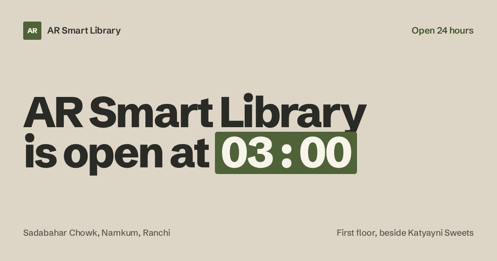

<div align="center">



# AR Smart Library

**A 24-hour reading library at Sadabahar Chowk, Namkum, Ranchi — and the site that says so.**

[](https://arsmartlibrary-psi.vercel.app/)
[](https://shogun-support-99.github.io/library/)
[](https://github.com/shogun-support-99/library/actions/workflows/pages.yml)

</div>

---

The library never closes. The site's headline says so with a live clock — *"AR Smart Library is open
at ⟨time⟩"*, ticked to Asia/Kolkata — so the central promise is shown rather than claimed.

Seven pages, one shared design system, no framework, no client-side router, no cookies, no third-party scripts.
Every fact on it comes from public business listings checked on 6 October 2026, and where a detail
could not be confirmed it is left out rather than filled in.

| | URL | Serves from |
| :--- | :--- | :--- |
| **Vercel** | <https://arsmartlibrary-psi.vercel.app/> | the domain root, `/` |
| **GitHub Pages** | <https://shogun-support-99.github.io/library/> | a sub-path, `/library/` |

The same `src/` builds both. Only `SITE_URL` and `BASE_PATH` differ, so canonicals, Open Graph tags,
the sitemap and every internal link are correct on each host. Both redeploy automatically on every
push to `main` — there is no manual deploy step to remember.

## The pages

| Page | Job |
| :--- | :--- |
| [`index`](site/src/pages/index.html) | The clock, the four facts, the ratings, and the way into the rest |
| [`about`](site/src/pages/about.html) | The story, who the room is for, and the rules this site writes by |
| [`facilities`](site/src/pages/facilities.html) | What is confirmed, what is not, and six questions to ask before travelling |
| [`membership`](site/src/pages/membership.html) | Why no prices are printed, and how the call goes |
| [`location`](site/src/pages/location.html) | The address, a drawn schematic of the chowk, hours, and what to tell an auto driver |
| [`faq`](site/src/pages/faq.html) | Seven short answers |
| [`contact`](site/src/pages/contact.html) | The one published route in |

## What this site refuses to do

These are content rules, not preferences. They are enforced by review, and they are why some pages
look sparse next to a competitor's.

- **No prices.** A rate quoted two years ago can be wrong in both directions. Membership sends people to the phone.
- **No unverified facilities.** Air conditioning, Wi-Fi, lockers, CCTV, parking, power backup, washrooms, private cabins, charging points and seat booking are named as *unconfirmed* — not claimed, not quietly omitted.
- **No WhatsApp CTA**, because no messaging route is confirmed. A dead link is not a service.
- **No copied reviews.** The scores are cited; the words belong to the people who wrote them, so they are linked.
- **No fake photographs.** None were supplied, and a stock reading room would be a lie — the picture slot holds the live clock and a drawn map instead.
- The ratings disclaimer stays: *taken on 6 October 2026 and can change.*

## Stack

- **Tailwind CSS v4** — configuration in CSS (`@theme`), not a JS config file: palette, five type steps, easings and `animate-*` tokens all become utilities.
- **A Node build script** (`site/build.mjs`) — front matter, includes, JSON-LD, sitemap, Tailwind CLI. No framework, no bundler.
- **Vanilla `app.js`** — the clock, rolling figures, scroll reveals, header state, menu. Decides *when* motion happens; Tailwind defines *what* it is.
- **Self-hosted typeface**, four woff2 files. No font CDN, no cookies, no third-party scripts.

## Run it locally

```bash
cd site
npm ci
npm run dev      # build, then rebuild on src/ changes
npm run serve    # in another shell — http://localhost:8080
```

Full detail — the front-matter format, the token map, the motion layer, every bug found and fixed —
is in [`site/README.md`](site/README.md).

## Verified, not assumed

Measured in headless Chromium against the built `dist/` at 1440, 768 and 390:

- **axe-core: 0 violations** on all seven pages at all three widths (`wcag2a`, `wcag2aa`, `wcag21a`, `wcag21aa`, best-practice)
- 0 console errors, 0 failed requests, 0 horizontal overflow
- one `<h1>` per page, two JSON-LD blocks per page, canonical + description everywhere
- complete without JavaScript, and with `prefers-reduced-motion` (0 running animations, nothing hidden)

Not claimed: there are no photographs of the library, and page transitions are progressive enhancement
only, for browsers that implement `@view-transition`.

---

## What else is here: nine agent skills

The site above was built with these. They are design and frontend skills for AI coding agents,
vendored at their upstream payload, unmodified, with the source commit recorded so they can be
audited or re-synced — nine skills from three upstream repositories. They overlap in intent and are
meant to be mixed, not installed as one system.

### impeccable — [pbakaus/impeccable](https://github.com/pbakaus/impeccable) · v4.7.0 · Apache-2.0

[`skills/impeccable/`](skills/impeccable/) · commit `8644175`

Design direction for AI-built interfaces. 24 commands (`craft`, `critique`, `audit`, `polish`, `bolder`, `quieter`, `distill`, `animate`, `harden`, `onboard`, …), 42 reference playbooks, 61 deterministic detector rules, and live browser iteration. The broadest toolbox here: auditing, polishing, edge cases, design-system docs, native iOS/Android. Runs from a shell launcher that fetches a self-contained binary — no Node.

### taste-skill — [Leonxlnx/taste-skill](https://github.com/Leonxlnx/taste-skill) · v2 · MIT

[`skills/taste-skill/`](skills/taste-skill/) · installs as **`design-taste-frontend`** · commit `6010f91`

Anti-slop art direction distilled from 247 curated gallery sites. Deals one of 20 researched directions (idea, composition, type, palette, photographs, section blueprints), enforces a no-ornament house style, then inspects its own render in a real browser at 1440/768/390. The sharpest opinionated option for blank page → designed landing page or app screen. Needs Node 22+ and Chrome/Edge/Chromium.

### UI/UX Pro Max bundle — [nextlevelbuilder/ui-ux-pro-max-skill](https://github.com/nextlevelbuilder/ui-ux-pro-max-skill) · v2.15.0 · MIT

commit `623a9a9` · one upstream repo shipping seven skills, vendored flat so each installs on its own:

| Skill | Folder | What it's for |
|---|---|---|
| **ui-ux-pro-max** | [`skills/ui-ux-pro-max/`](skills/ui-ux-pro-max/) | The core: a searchable local database of 79 styles, 192 product palettes with reasoning profiles, 74 font pairings, 119 UX guidelines, 105 icons, 17 GSAP presets, 25 chart types and 22 tech stacks. Python search CLI over CSV. |
| **design** | [`skills/design/`](skills/design/) | The umbrella: brand identity, tokens, UI styling, logo generation (55 styles), corporate identity programs, HTML presentations, banners, icons. Largely subsumes `banner-design` and overlaps `design-system`. |
| **design-system** | [`skills/design-system/`](skills/design-system/) | Three-layer token architecture (primitive → semantic → component), component specs, CSS variables, spacing/typography scales, strategic decks. |
| **ui-styling** | [`skills/ui-styling/`](skills/ui-styling/) | shadcn/ui + Radix + Tailwind implementation, plus canvas-based visual design. Ships 54 OFL fonts with their license files under `canvas-fonts/`. |
| **brand** | [`skills/brand/`](skills/brand/) | Brand voice, visual identity, messaging frameworks, asset management, consistency checks. |
| **banner-design** | [`skills/banner-design/`](skills/banner-design/) | Banners for social, ads, heroes and print; 22 styles across platform-specific sizes. |
| **slides** | [`skills/slides/`](skills/slides/) | HTML presentations with Chart.js, design tokens and responsive layouts. |

## Installing a skill

Link a skill into your agent's skill directory:

```bash
./install.sh                 # project-local ./.claude/skills
./install.sh --user          # ~/.claude/skills
./install.sh --all-agents    # ~/.claude/skills and ~/.codex/skills
./install.sh impeccable      # just one skill
./install.sh ui-ux-pro-max brand   # or several
./install.sh --list          # install names
./install.sh --uninstall     # remove the links
```

Links point back into this repo, so `git pull` updates installed skills in place. Use `--copy` if your environment has no symlinks.

Installed directories are named from each `SKILL.md` frontmatter, so taste-skill installs as `design-taste-frontend`. Folder names match upstream otherwise.

## Requirements

- **impeccable**: no runtime needed; the launcher downloads its binary once. Live-browser commands need a Chromium-family browser.
- **taste-skill**: Node 22+, Chrome/Edge/Chromium, network for `assets.mjs`. No API keys.
- **ui-ux-pro-max**: Python 3 for `scripts/search.py` and the data validators; no extra packages for search. `ui-styling` has a `requirements.txt` for its canvas work, and the `.cjs`/`.py` token and slide scripts want Node.
- **brand / design-system**: Node for the `.cjs` token scripts, Python for the slide and validation scripts.

## Layout

```
skills/
  impeccable/        SKILL.md, reference/ (42), agents/ (4), scripts/, LICENSE, NOTICE.md
  taste-skill/       SKILL.md, references/ (11), library/ (9 JSON), scripts/, assets/, evals/
  ui-ux-pro-max/     SKILL.md, data/ (12 domain CSVs + 22 stack CSVs), references/, scripts/ (Python)
  design/            SKILL.md, data/, references/, scripts/ (cip, icon, logo)
  design-system/     SKILL.md, data/, references/, scripts/, templates/
  ui-styling/        SKILL.md, references/, scripts/, canvas-fonts/ (54 TTF + OFL)
  brand/             SKILL.md, references/, scripts/, templates/
  banner-design/     SKILL.md, references/
  slides/            SKILL.md, references/
```

Each folder is self-contained and portable: `SKILL.md` plus whatever it needs, its upstream `LICENSE`, and a `PROVENANCE.json`.

## Provenance

Every skill folder carries a `PROVENANCE.json` with the upstream URL, the exact commit vendored, the version, and the download date. Upstream files are otherwise untouched.

Two sizing decisions were made while vendoring:

- **impeccable** ships ~20 byte-identical copies for different agents (`.claude/`, `.cursor/`, `.gemini/`, `plugin/`, …) differing only in frontmatter and fallback paths. Only the canonical `.agents/` payload is vendored; keeping the rest would have added ~45 MB of duplication.
- **UI/UX Pro Max** also ships a subset copy under `cli/assets/skills` for its npm installer, missing `ui-styling/canvas-fonts` and all of `ui-ux-pro-max`. The `.claude/skills` payload is canonical and is what is vendored. One upstream test artifact (`ui-styling/scripts/.coverage`) was dropped.

## Licenses

Each skill keeps its own `LICENSE` inside its folder: impeccable is Apache-2.0 (third-party notices in `NOTICE.md`), taste-skill and the UI/UX Pro Max bundle are MIT. The 54 fonts in `ui-styling/canvas-fonts/` are OFL, each with its license file alongside. Those terms govern the vendored content.
